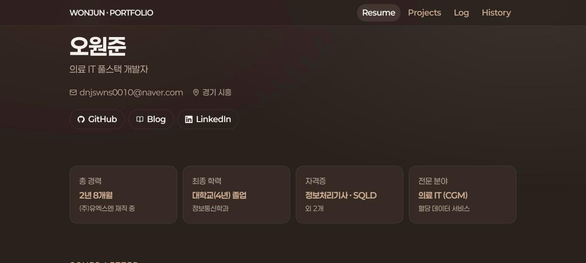
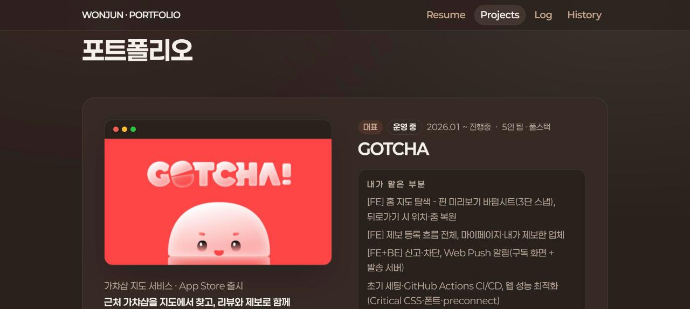
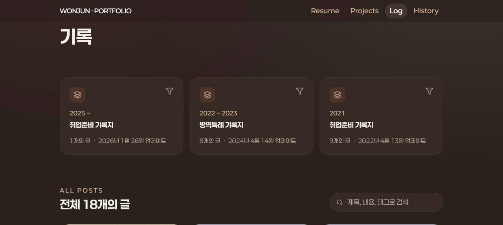
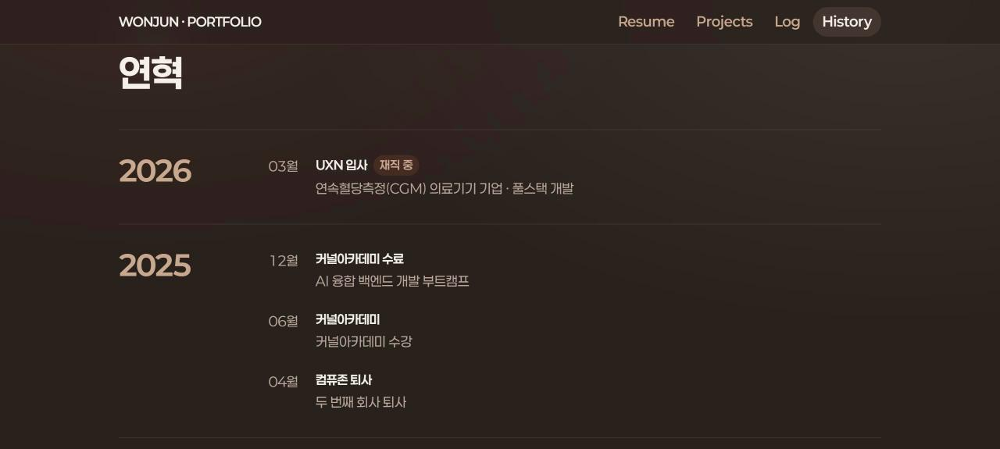

<div align="center">

# wonjun.page

저의 이력서, 프로젝트, 블로그를 모아둔 사이트입니다.<br>
각 프로젝트에서 어떤 기능을 만들었고 제가 어디를 맡았는지 자세히 정리해두었습니다.

</div>

<br>

## 화면


<table>
<tr>
<td width="50%"></td>
<td width="50%"></td>
</tr>
<tr>
<td align="center">이력서</td>
<td align="center">프로젝트</td>
</tr>
<tr>
<td width="50%"></td>
<td width="50%"></td>
</tr>
<tr>
<td align="center">블로그</td>
<td align="center">연혁</td>
</tr>
</table>

<br>

## 페이지

| 경로 | 내용 |
|---|---|
| `/` | 홈 - 한 줄 소개, 결과 지표, 대표 프로젝트, 최근 글, GitHub 잔디 |
| `/resume` | 이력서 - 경력·프로젝트·학력·자격증·기술 |
| `/projects` | 프로젝트 - 핵심 기능 → 내가 맡은 부분 순서로 정리 |
| `/history` | 연혁 - 공부와 경력의 흐름 |
| `/log` | 블로그 - 네이버 블로그 글을 시리즈별로 모아 보기 (누르면 원문으로) |

<br>

## 만든 방식

### 서버·DB 없이 프론트만으로

처음엔 Spring 백엔드 + DB로 만들었지만, 내용이 자주 바뀌지 않는 개인 사이트라 데이터를 전부 코드로 옮겼습니다.
서버 비용과 관리할 것이 사라지고, 내용을 고친 이력이 커밋으로 남습니다.

| 데이터 | 위치 |
|---|---|
| 이력서 | `src/lib/about.ts` |
| 프로젝트 | `src/lib/projects.ts` |
| 연혁 | `src/lib/history.ts` |
| 블로그 글 목록 | `src/content/posts.json` + 썸네일 `public/blog/naver/` |
| GitHub 잔디 | GitHub API 로 직접 조회 (1시간 캐시) |

### 네이버 블로그 자동 동기화

- 매일 09:00 GitHub Actions 가 네이버 블로그 RSS 를 확인하고, 새 글이 있으면 dev 로 가는 PR 을 자동으로 엽니다 (`.github/workflows/sync-naver.yml` → `scripts/sync-naver.mjs`)
- RSS 는 최근 50개만 주기 때문에, 한 번 받은 글은 지우지 않고 파일에 쌓아 둡니다
- 네이버 이미지는 다른 사이트에서 바로 띄우면 막혀서(403) 썸네일을 레포에 저장합니다

### 디자인

- 에스프레소 브라운 배경에 벽돌 레드·라떼 포인트, 잔디는 포레스트 그린
- 색은 `src/app/globals.css` 의 디자인 토큰으로만 씁니다 (링크 미리보기 이미지는 CSS 를 못 써서 예외)
- 폰트는 페이퍼로지(Paperozi)

<br>

## 기술

     

<br>

## 배포

- `dev` 에 모아서 확인한 뒤 `main` 으로 머지하면 Vercel 이 운영에 배포합니다
- 옛 주소 `wonjun-portfolio-kr.vercel.app` 은 `wonjun.page` 로 넘어갑니다 (308)

<br>

## 로컬 실행

```bash
npm install
npm run dev   # http://localhost:3000
```

네이버 새 글 직접 가져오기:

```bash
node scripts/sync-naver.mjs
```
